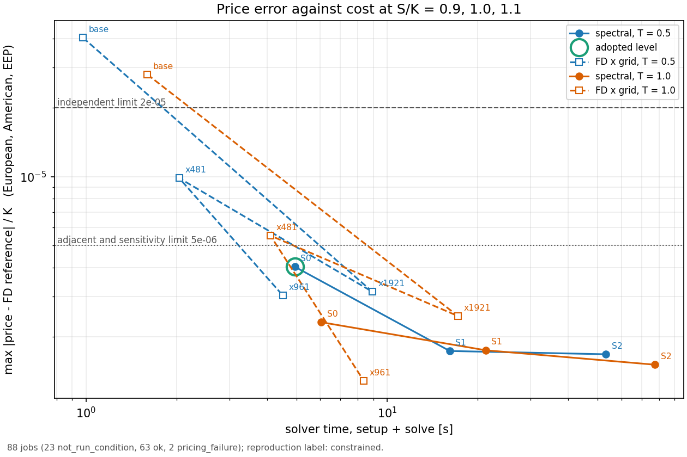
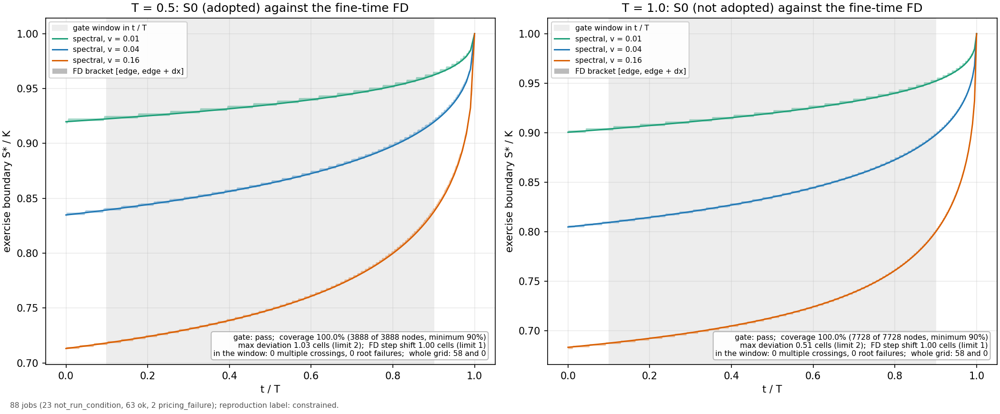
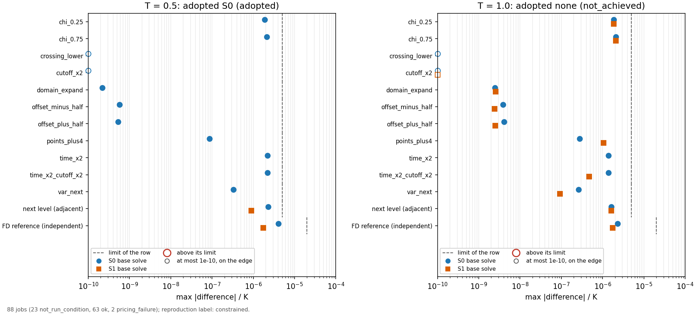

# DSINC：3/2モデルのAmerican putを固定周波数spectral法で再現する

進捗と判定は[ROADMAPの現在地](../../ROADMAP.md)が正。設計は[設計](../../docs/superpowers/specs/2026-10-25-dsinc-american-design.md)、実装の順序とAPIは[実施計画](../../docs/superpowers/plans/2026-10-25-dsinc-american.md)。

状態（2026-10-27）：mainを実行済み。`reproduction_label`は`constrained`。論文の印刷値への照合（paper_match）は通った。独立検証はT=.5だけが通り（S0を採用）、T=1は採用段がない（`not_achieved`）。独立レビューはこの後に受ける。結果は[結果](#結果)。

## 目的と範囲

市場データを使わず、定数係数3/2モデルのAmerican putについて、European価格・早期行使プレミアム（EEP）・行使境界をローカルCPUで再現し、誤差と費用を独立な方法で評価する。速度向上は採択条件にしない。

- モデル：dS=(rd−rf)S dt+√v S dW_S、dv=κv(θ−v)dt+ξv^(3/2) dW_v、d⟨W_S,W_v⟩=ρdt。payoffは(K−S)⁺、行使は連続。
- v1の入力範囲：S,K>0、T≥0、rd>rf≥0、κ,θ,v0,ξ>0、|ρ|<1。3/2はtrue-martingale領域 ρξ≤κ+ξ²/2に限る。T=0はexact payoffを返す。範囲外、NaN/Inf、無効な格子や減衰はValueErrorにし、clipや代用値で隠さない。
- 単位：時間は年、金利は連続複利の年率。v,θは分散率（ボラではない）。価格はKで割って比べる。
- 「再現済み」と言える範囲：論文の印刷値への照合（paper_match）と、独立FDへの照合（independent_validated）の両方が通った宣言範囲だけ。通らなければ「未再現/制約付き」と記録する。
- 含めないもの：SABR、GARCH、lognormal-vol、負金利、rd<rf、strict local martingale、時変係数、Bermudan金利商品、較正、実市場データ、NN、教材サイトへの組込み。Hestonは制御実験用の作用素と公開コードの比較にだけ使い、新しい公開Heston APIは作らない。

実装はhullkitのprivateモジュール3本と、このディレクトリの研究コード。

- [`_dsinc_types`](../../hullkit/src/hullkit/_dsinc_types.py)：入力型・検証・digest・境界の状態コード。
- [`_dsinc_spectral`](../../hullkit/src/hullkit/_dsinc_spectral.py)：周波数則・作用素・伝播・European・v0補間・診断。
- [`_dsinc_american`](../../hullkit/src/hullkit/_dsinc_american.py)：EEPの再帰（Eq.(57)）と節点ごとの行使境界（Eq.(58)）。
- [`reference_fd.py`](reference_fd.py)：独立な3/2のFD。spectralの作用素・payoff変換・境界solverをimportしない。
- [`gates.py`](gates.py)：判定の純関数。[`run.py`](run.py)：protocolからjobを作り、予算つきのsubprocessで走らせ、判定・照合・書き出しをするrunner。[`plot.py`](plot.py)：図。
- [`protocol.json`](protocol.json)：設定・閾値・予算。[`cases.json`](cases.json)：論文の印刷値と上流Hestonの入力。[`freeze_manifest.json`](freeze_manifest.json)：mainの固定。[`pilot_summary.json`](pilot_summary.json)：freezeの元になったpilot。
- [`heston_baseline.py`](heston_baseline.py)と[`upstream/`](upstream/)：上流Hestonの監査。原本は固定commitのまま変えない。

## 方法と出典

- 新方式：Andrey Itkin, *DSINC beyond Heston: the 3/2 and other non-affine stochastic-volatility models*, 2026-10-20, [arXiv:2610.28847v1](https://arxiv.org/html/2610.28847v1)。対応箇所はEq.(14), (53), (57)–(61)、§5.3–5.5、Tables 3–6, 9。
- 基礎：Andersen, Itkin, Kazbek, [arXiv:2606.27335v1](https://arxiv.org/abs/2606.27335v1)。
- 公開Heston実装：[DSINC-AMERICAN-HESTON](https://github.com/rakhymzhan11/DSINC-AMERICAN-HESTON/tree/20cfb802673b0a792984d25e1f45cd09d37e8c07)（固定commit）。Heston版であり、3/2版そのものではない。監査と比較は[`heston_baseline.py`](heston_baseline.py)。pilotでは上流の11件を比べた。結果は[`pilot_summary.json`](pilot_summary.json)の`heston`にあり、全件`certified: false`で、上流の値は基準に使っていない。

固定周波数の伝播とEuropean（`_dsinc_spectral`）は次の順で組む。

1. x=log(S/K)、ζ=log vとし、反射周波数k=−ω−iχ（0<χ<1）ごとに、割引を含まない作用素 A_k f=½a²f″+(b+ikρ√v·a)f′+{ik(rd−rf)−½(k²+ik)v}f を、ζ格子の中心差分で組む。3/2はa=ξ√v、b=κθ−(κ+ξ²/2)v。Hestonの制御用はa=ξ/√v、b=κθ/v−κ−ξ²/(2v)。どちらも同じ組立てを通り、a,bだけが違う。−rdは作用素に入れず、価格側で一度だけ掛ける。
2. 両端はghost節点で反射する（一次微分0、二次微分2(f_隣−f_端)/h²）。
3. ωは正周波数のパネルごとのGauss–Legendre。M_k=expm(Δt·A_k)をωごとに1回作る（Δt=T/n_time）。伝播行列は(rd, rf, T, モデル, 設定, 係数のtag)のdigestに結びつけ、別の入力で作った行列を渡すとValueErrorにする。strikeは結びつけない。
4. EuropeanはEq.(61)。s=iω−χ、E_j=M_j^N·1として、ζ節点の値 e^{−rdT}[1+(1/π)Re Σ_j ϖ_j e^{(χ−iω_j)x}E_j/(s_j(1+s_j))] を求め、v0へnot-a-knotの3次スプラインで補間する。v0が格子の外ならValueErrorにする（外挿しない）。
5. 診断として、セルPeclet数|b|h/a²と、k=0の伝播行列M₀の最小成分・行和誤差を記録する。中心差分は低分散で非単調になりうるため、M₀の最小成分が−1e-10未満ならscheme_nonmonotoneとし、正値性を保証したとは扱わない。

EEPと境界（`_dsinc_american`）は、t_n=nT/Nの台形則（t_Nは半重み、t_0は重みなし）でEEPを後ろ向きに足す。1段は Q_n=e^{−rdΔt} M(w P(x*_{n+1})+Q_{n+1})、E_n=M E_{n+1} で、一括のmatmul 1回にEuropeanの脚も含まれる。各(t_n, ζ_i)の境界x*は、Eq.(58)の残差R_n(x)（payoff−継続価値。無次元で、価格/Kの残差）の根である。前の時刻の境界pの周りに幅0.1・0.2・0.3・0.5（D-6）のbracketを作り、R(lo)>0>R(hi)を必須にして走査し、最上位の+→−交差を選び（D-1）、二分法で解く。符号変化なし・逆向き・曖昧な零・非有限・反復超過は、その時刻の全節点を記録してから`PricingFailure`にする。clipや代用値は使わない。

独立FD（`reference_fd.py`）は、x,ζのSDEから直接組む。Rannacher起動のあとCN、AmericanはIkonen–Toivanenのsplittingを使う。参照値は、基準格子B=(241,101,300T)に、x・分散・時間の各軸の最細水準の補正を足して作る（D-3）。領域を広げたときの差も検査する。

検算はDSINC全体で135件（`test_dsinc_*.py`：types 33、baseline 17、spectral 22、reference 11、american 18、gates 15、runner 19）。[`test_dsinc_spectral.py`](../../hullkit/tests/test_dsinc_spectral.py)には、Itô係数、定数分散で作用素がBSMの指数に一致すること、1/vのCIR平均（二次の収束）、既存のHeston特性関数価格、χ=.25/.5/.75でのBSM、v0格子の半セルずらし、Table 3(b)のEuropean 3点（許容6e-6）を置いた。

| 区分 | 項目 |
|---|---|
| 論文由来 | 作用素Eq.(53)、3/2の係数（Itôで導出し直したもの）、ζ格子[log 2e-4, log 2]と160節点、パネル{0,…,640}の各12点、反射周波数とχ=.5、n_time=200T、端点の半重み、EEPの再帰Eq.(57)と境界の式Eq.(58)（端点項dt·g/4は境界の式だけ） |
| 独自の選択 | ghost反射のNeumann、not-a-knotによるv0補間、根の走査と最上位の交差（D-1）、根を探す幅の予備0.5（D-6）、上下界を通らない段を採用しない規則（D-7）、段S1・S2と感度の設定、独立FD、1e-200未満の成分の0化 |

独自の選択による差は、論文の印刷値への照合基準（|差|/K≤6e-6）の中で説明する。mainで測った差は最大3.4e-7で、この基準の内側にある。D-1・D-6・D-7は設計からの逸脱として承認済みの規則で、根拠は[実施計画の§1](../../docs/superpowers/plans/2026-10-25-dsinc-american.md)に記録している。D-6は`root_widths`を0.1・0.2・0.3・0.5とする。幅は小さい順に試し、符号変化が見つかった節点はそこで確定するので、0.5が効くのは0.3までで符号変化がない節点だけで、他の節点の結果は変わらない。D-7は、価格を出した全spot（主3点・Deltaのbump・境界の走査点）で上下界（許容2e-5）を通らない段を採用しない規則である。最初のpilotでS0のT=1がAmerican−payoff −2.36e-5（S/K=.8）で外れたため、2026-10-27に承認して加えた。

伝播行列は、expmの直後に実部・虚部の絶対値が1e-200未満の成分を0にして保存する（独自の選択）。この大きさの成分は倍精度の価格に影響せず、残すとEEP再帰の一括matmulが遅くなるため。遅くなる原因は二つある：subnormalの成分（約2.2e-308未満）そのものと、約2.2e-308〜1e-200のnormalな成分が作る、subnormalになる積。0にする非零の成分は、個数ではS0のT=0.5でnormalが94%、subnormalが6%である。S1のT=0.5の`american_put`で`_FLUSH_BELOW`を実行時に差し替え、順序を変えて測った再帰の時間は、0化なしで6.8秒前後、subnormalの成分だけ0にして5.4〜5.6秒、1e-200未満を0にして約4.8秒だった。節約の約3分の2がsubnormalの成分そのもの、残りがnormalな成分による。S0・S1・S2のT=0.5と1のどれでも、0化の有無で価格・節点境界・状態・診断の全出力がビット一致し、S2のT=1のwallは97.8秒から76.2秒になった。

## 判定の規則

設定と閾値は[`protocol.json`](protocol.json)で決め、mainの前に[`freeze_manifest.json`](freeze_manifest.json)で固定した。比較はすべて価格/Kで、spotはS/K=.9, 1, 1.1、量はEuropean・American・EEP（=American−European）。「最大差」は3 spot×3量の最大を指す。契約はK=1、rd=.05、rf=.02、モデルはκ=20、θ=v0=.04、ξ=4、ρ=−.5、満期はT=.5と1。

| 段 | 分散節点 | 時間の歩数 | 周波数のcutoff | 1パネルの点数 | 周波数点 |
|---|---|---|---|---|---|
| S0 | 160 | 200T | 640 | 12 | 108 |
| S1 | 240 | 400T | 1280 | 12 | 120 |
| S2 | 320 | 800T | 2560 | 16 | 176 |

- paper_match：S0の値を、Table 4のAmerican 3点（T=.5、N=100）、Table 3(b)のEuropean 3点、Table 9のT=1のATM 1点の計7点と比べる。|差|≤6e-6。T=1の非ATM 2点は印刷値がなく`not_available`。採用段に関わらずS0の値で判定する。EEP列、N=200列、FDの列は診断で、停止条件にしない。
- 段の採用：S0、S1の順に、次の4つがすべて成り立つ最初の段を採用する。値がない検査は不合格として扱う。どちらも通らなければ`not_achieved`（感度が走らなかっただけの候補があれば`not_achieved_budget`）。S2はS1の隣として使うだけで、採用しない。
  1. 隣の段との最大差≤5e-6（S0はS1と、S1はS2と比べる）。
  2. 独立FD参照との最大差≤2e-5。
  3. 感度11本それぞれの最大差≤5e-6。採用候補の段を起点に、一軸ずつ変える：crossing_lower（最下位の交差を選ぶ）、time_x2、time_x2_cutoff_x2、var_next、points_plus4、cutoff_x2、chi_0.25、chi_0.75、domain_expand、offset_plus_half、offset_minus_half。S1の感度は、その満期でS0が採用されなかったときだけ走らせる条件付きのjobである（D-5）。
  4. 価格を出した147 spot（主3点、Deltaのbump 18点、境界の走査126点）で上下界を通る（許容2e-5。D-7）：American≥European、American≥payoff、European≥下界、American≤K、European≤e^{−rdT}。
- 境界gate：窓はt/T∈[.1,.9]、v∈[.01,.16]。spectralの境界を、FDの接触端をζで補間したbracket [edge, edge+dx]（dx=.0025）と比べる。FDまたはspectralの境界がx端から4セル以内の節点と、bracketが取れない節点はmask（geometry_invalid）する。有効な節点のcoverage≥90%、最大の外れ≤2セル、窓内のmultiple_crossingsは0、根の失敗は0、最大の根の残差≤1e-8、刻みを半分にしたFDとの接触端のずれ≤1セル。
- `reproduction_label`：`reproduced`はpaper_matchが通り、全満期でpriceが成立し境界がpassのとき。`constrained`はpaper_matchが通り、priceが成立した満期が一部のとき。それ以外は`not_reproduced`。priceが成立するとは、採用段があり、FD参照が収束し、その段が上下界を通ること。

## 結果

mainは2026-10-27に実行した（run id `main-20261027T001446Z`、88件、783秒）。freezeはmanifest_sha256 `d3685d179da77af2abb2d935ce26d050d27d5e5b26cf5a7ad07901438f809d37`で、`results.json`の`freeze_sha256`と一致する。freezeは、2026-10-26 UTC 23:53のpilot（42件すべてok）から作った。最初のpilot（2026-10-26）は`mandatory_jobs_ok`が落ちて止まり、D-6・D-7を承認してから取り直した。run rootはGit管理外の`/home/kazumasa/projects/_data/johnhull/DSINC/main-20261027T001446Z/`で、19,848,472 bytes（18.9 MiB、180ファイル。目標50 MiB以下）。`run.py replay`は`{"match": true, "differences": []}`だった。研究ディレクトリへは、[`results/`](results/)（`results.json` 768,324 bytes、境界の配列4本、sha256つきの`manifest.json`）と[`figures/`](figures/)を書き出した。各ファイルは2,000,000 bytes以下。以下の数値は`results.json`の`verdicts`と`records`、`pilot_summary.json`から転記した。節点の位置とt=0の境界は、run rootに記録した配列（`arrays/*.npz`）から読んだ。

### 判定の要約

| 項目 | T=.5 | T=1 |
|---|---|---|
| 採用段（`selections.adopted`） | S0 | なし（`not_achieved`） |
| 採用しなかった理由 | — | S0は上下界で不合格（D-7）。S1は感度2本のjobが失敗して判定できない |
| price（`independent_validated`） | true | false |
| 境界gate | pass（S0） | pass（S0。採用段ではない） |
| `nonmonotone_effect` | confirmed | unsupported |

`reproduction_label`は`constrained`。paper_matchは通り、priceが成立した満期はT=.5だけだった。再現済みと言えるのは、T=.5・S/K=.9, 1, 1.1・上の1組のパラメータの範囲で、paper_matchと独立検証の両方が通ったため。T=1は、S0のATM 1点が印刷値に合っただけで、価格と境界の独立検証は通っていないので、再現済みとは言わない。T=1のS0の境界はFDの境界に合う（最大の外れ0.51セル）が、S0はT=1で採用されていないため、独立検証の成立には数えない。

`nonmonotone_effect`は、中心差分の非単調（M₀の最小成分が−0.0316、セルPecletの最大が14.4、Pe>1の節点が45）が出た入力で、採用段が価格・境界・paper_matchの各gateを通ったかを表す。T=.5はconfirmed。T=1は採用段がないので、影響を確認できていない（unsupported）。

### 文献照合（paper_match）

pass。7点の最大差は3.4e-7で、許容6e-6の約1/17。差はS0−印刷値（price/K）。

| 論文の列 | S/K | 印刷値 | S0 | 差（S0−印刷値） |
| --- | --- | --- | --- | --- |
| Table 4 American、N=100、T=.5 | 0.9 | 0.107601 | 0.1076009 | -6.3e-8 |
|  | 1.0 | 0.048662 | 0.0486622 | +2.4e-7 |
|  | 1.1 | 0.019499 | 0.0194991 | +5.2e-8 |
| Table 3(b) European、T=.5 | 0.9 | 0.102557 | 0.1025573 | +3.4e-7 |
|  | 1.0 | 0.047224 | 0.0472243 | +2.6e-7 |
|  | 1.1 | 0.019105 | 0.0191047 | -3.4e-7 |
| Table 9 American、T=1、ATM | 1.0 | 0.063668 | 0.0636679 | -1.1e-7 |

診断の列（停止条件ではない）。

| 診断列 | 差（S/K=.9 / 1 / 1.1） | 最大差 | 出所 |
| --- | --- | --- | --- |
| Table 4 EEP、T=.5 | -4.07e-7 / -2.51e-8 / +3.91e-7 | 4.066e-7 | main |
| Table 4 DSINC N=200、T=.5（S0の時間倍） | +3.70e-7 / +9.64e-9 / +9.28e-8 | 3.703e-7 | main |
| Table 4 FD coarse、T=.5（論文の格子241×101×300T） | -8.48e-8 / -5.13e-7 / +4.71e-7 | 5.131e-7 | pilot |
| Table 4 FD fine、T=.5（481×201×600T） | -4.83e-7 / +1.39e-7 / -4.37e-7 | 4.828e-7 | pilot |
| Table 9 FD fine、T=1、ATM | +2.15e-7 | 2.154e-7 | pilot |

FDの3列はmainのrosterになく、`results.json`では空である。値は、2026-10-26 UTC 23:53のpilotの[`pilot_summary.json`](pilot_summary.json)（`paper_diagnostics`）から転記した。T=1の非ATM 2点は印刷値がない（`not_available`）。

### 6件の価格

price/K。EEP=American−European。差は spectral−reference。referenceは独立FDで、最終細分差はT=.5でx軸1.89e-6・分散軸2.6e-7・時間軸2.7e-7、T=1でx軸1.40e-6・分散軸5.8e-7・時間軸1.2e-7、領域を広げた差は1.4e-13と7.2e-12（全軸とも収束と判定）。

T=.5（採用段S0）。

| S/K | 量 | spectral S0 | reference | S0−reference |
| --- | --- | --- | --- | --- |
| 0.9 | European | 0.1025573 | 0.1025571 | +2.25e-7 |
|  | American | 0.1076009 | 0.1075998 | +1.09e-6 |
|  | EEP | 0.0050436 | 0.0050427 | +8.64e-7 |
| 1.0 | European | 0.0472243 | 0.0472237 | +5.31e-7 |
|  | American | 0.0486622 | 0.0486582 | +4.04e-6 |
|  | EEP | 0.0014380 | 0.0014345 | +3.51e-6 |
| 1.1 | European | 0.0191047 | 0.0191042 | +4.25e-7 |
|  | American | 0.0194991 | 0.0194955 | +3.52e-6 |
|  | EEP | 0.0003944 | 0.0003913 | +3.10e-6 |

T=1（採用段なし。S0とS1の値は参考で、検証済みとは言わない）。

| S/K | 量 | spectral S0 | spectral S1 | reference | S0−reference | S1−reference |
| --- | --- | --- | --- | --- | --- | --- |
| 0.9 | European | 0.1075672 | 0.1075670 | 0.1075671 | +1.24e-7 | -7.85e-8 |
|  | American | 0.1163362 | 0.1163348 | 0.1163359 | +3.38e-7 | -1.01e-6 |
|  | EEP | 0.0087690 | 0.0087678 | 0.0087687 | +2.15e-7 | -9.35e-7 |
| 1.0 | European | 0.0602128 | 0.0602126 | 0.0602126 | +2.35e-7 | +5.18e-8 |
|  | American | 0.0636679 | 0.0636663 | 0.0636661 | +1.84e-6 | +2.27e-7 |
|  | EEP | 0.0034551 | 0.0034536 | 0.0034535 | +1.60e-6 | +1.76e-7 |
| 1.1 | European | 0.0323014 | 0.0323013 | 0.0323012 | +1.99e-7 | +9.13e-8 |
|  | American | 0.0336949 | 0.0336944 | 0.0336926 | +2.31e-6 | +1.74e-6 |
|  | EEP | 0.0013935 | 0.0013931 | 0.0013914 | +2.11e-6 | +1.65e-6 |

最大差は、T=.5のS0が4.04e-6（American、S/K=1）、T=1のS0が2.31e-6（American、S/K=1.1）、T=1のS1が1.74e-6（American、S/K=1.1）。S1とS2のreferenceとの差は1.5〜1.7e-6で下げ止まる（T=.5のS1 1.73e-6・S2 1.68e-6、T=1のS1 1.74e-6・S2 1.51e-6）。referenceの最終細分差（1.4〜1.9e-6）と同じ大きさなので、これより小さい誤差はこの参照では分解できない。

### 満期ごとの採用段と感度

各検査の最大差（3 spot×3量）。

| 検査 | 上限 | T=.5 S0 | T=1 S0 | T=1 S1 |
| --- | --- | --- | --- | --- |
| 隣の段との差 | ≤5e-6 | 2.31e-6 | 1.61e-6 | 1.62e-6 |
| 独立FD参照との差 | ≤2e-5 | 4.04e-6 | 2.31e-6 | 1.74e-6 |
| 上下界 | ≥−2e-5 | pass（American−payoff最小 -1.54e-5、S/K=0.832） | fail（American−payoff最小 -2.36e-5、S/K=0.8） | pass（American−payoff最小 -8.28e-6、S/K=0.802） |
| 感度 crossing_lower | ≤5e-6 | 0 | 0 | 判定なし（ジョブ失敗） |
| 感度 time_x2 | ≤5e-6 | 2.23e-6 | 1.38e-6 | 判定なし（ジョブ失敗） |
| 感度 time_x2_cutoff_x2 | ≤5e-6 | 2.23e-6 | 1.38e-6 | 4.75e-7 |
| 感度 var_next | ≤5e-6 | 3.31e-7 | 2.62e-7 | 9.24e-8 |
| 感度 points_plus4 | ≤5e-6 | 8.66e-8 | 2.81e-7 | 1.05e-6 |
| 感度 cutoff_x2 | ≤5e-6 | 5.16e-15 | 1.77e-14 | 6.94e-18 |
| 感度 chi_0.25 | ≤5e-6 | 1.90e-6 | 1.86e-6 | 1.86e-6 |
| 感度 chi_0.75 | ≤5e-6 | 2.13e-6 | 2.11e-6 | 2.11e-6 |
| 感度 domain_expand | ≤5e-6 | 2.21e-10 | 2.45e-9 | 2.57e-9 |
| 感度 offset_plus_half | ≤5e-6 | 5.29e-10 | 4.10e-9 | 2.52e-9 |
| 感度 offset_minus_half | ≤5e-6 | 5.76e-10 | 3.89e-9 | 2.40e-9 |
| 感度の最大 |  | 2.23e-6 | 2.11e-6 | なし（2本に値がない） |
| 判定 |  | 採用 | 不採用（上下界） | 不採用（感度の判定なし） |

T=.5はS0を採用した。S0は4つの検査をすべて通った。S1は隣の段との差8.88e-7、参照との差1.73e-6で上下界も通るが、S0が先に採用されたので感度は走らせていない（条件付きの11件は`not_run_condition`）。

T=1は採用段がない（`not_achieved`）。

- S0は、隣の段・参照・感度（最大2.11e-6、chi_0.75）を通るが、上下界で落ちた。American−payoffの最小が-2.36e-5（S/K=.8）で、許容の-2e-5を下回る（D-7）。
- S1は、隣の段・参照・上下界（-8.28e-6）を通る。感度11本のうち9本は最大2.11e-6で、上限の内側にある。残る2本のjobは`pricing_failure`で、値がない。
  - `crossing_lower`：満期の3段前（時刻index 397/400、t=.9925）で59節点が`wrong_orientation`（bracketの符号変化が逆向き）。
  - `time_x2`：800歩の途中（index 430/800、t=.5375）で1節点が`ambiguous_contact`（残差が許容内の走査点が2点以上続く）。
  - 失敗した節点はどちらも分散が小さい側（crossing_lowerはv=2.0e-4〜1.9e-3、time_x2はv=4.7e-4）で、境界gateの窓（v∈[.01,.16]）の外にある。1節点でも根が取れなければ、その時刻の全体を失敗として記録し、価格を出さない。
  - 値がない検査は不合格として扱うので、S1の感度のgateは判定できず、S1は採用されない。この2本の合否は不明で、S1が感度のgateを通るとは言えない。
- S2は採用の候補ではない。

閾値・規則・コードは変えておらず、再実行もしていない。

### 境界gate

T=1は採用段がないので、どちらの満期もS0の境界を判定した。T=1のpassは採用の根拠にならない。

| 項目 | 基準 | T=.5（S0） | T=1（S0） |
| --- | --- | --- | --- |
| 判定 |  | pass | pass |
| 対象節点（共通時刻、窓内） |  | 3888 | 7728 |
| 有効（maskなし） | coverage ≥90% | 3888（100.0%） | 7728（100.0%） |
| mask（geometry_invalid） |  | 0 | 0 |
| 最大の外れ［セル］ | ≤2 | 1.027 | 0.511 |
| FDの時間刻みによる接触端のずれ［セル］ | ≤1 | 1.000 | 1.000 |
| 窓内のmultiple_crossings | 0 | 0 | 0 |
| 窓内の根の失敗 | 0 | 0 | 0 |
| 全格子のmultiple_crossings |  | 58 | 58 |
| 最大の根の残差 | ≤1e-8 | 1.7e-11 | 1.7e-11 |

- FDの時間刻みによるずれは、primary（1200T歩）と確認用（600T歩）の接触端の最大の差で、両満期とも上限の1セルに一致した（記録値は1.0000000000000675。判定は上限+1e-9まで許す）。1セルはFD格子の最小の動きである。
- 全格子の多重交差58節点は、両満期で同じ位置にある：満期の手前7段（τ=.005〜.035）、v≤6.75e-4の22節点。窓の外にあり、最上位の交差を採った。最上位と最下位の交差のxの距離は最大0.0078。根の一意性を証明するものではない。
- maskは0件なので、図に×印は出ない。

### 費用

単一core、単一スレッド。cold setupは、伝播行列の構築（spectral）、または演算子の組立てとLU分解（FD）。warm queryは、setup済みの再帰と価格の問い合わせ（spectral。うち問い合わせは2.5〜6.8 ms）、またはFDの時間発展。1回のsolveで147 spotの価格と境界を同時に返す。

| 方式・設定 | T | cold setup［s］ | warm query［s］ | wall［s］ | 最大RSS［MiB］ | referenceとの最大差 |
| --- | --- | --- | --- | --- | --- | --- |
| spectral S0（160節点・200T歩） | 0.5 | 3.87 | 1.07 | 5.41 | 162.7 | 4.04e-6 |
| spectral S1（240節点・400T歩） | 0.5 | 11.26 | 4.89 | 16.62 | 231.8 | 1.73e-6 |
| spectral S2（320節点・800T歩） | 0.5 | 30.40 | 22.91 | 53.82 | 417.8 | 1.68e-6 |
| spectral S0 | 1.0 | 3.87 | 2.18 | 6.51 | 162.6 | 2.31e-6 |
| spectral S1 | 1.0 | 11.16 | 10.09 | 21.74 | 232.8 | 1.74e-6 |
| spectral S2 | 1.0 | 30.14 | 47.45 | 78.12 | 419.2 | 1.51e-6 |
| FD x=1921（独立参照の最細、1921×101×300T、European+American） | 0.5 | 0.69 | 8.24 | 9.39 | 688.2 | —（referenceの一部） |
| FD 境界用primary（961×101×1200T） | 0.5 | 0.42 | 8.48 | 9.37 | 399.2 | — |
| FD x=1921 | 1.0 | 0.66 | 16.54 | 17.66 | 687.9 | —（referenceの一部） |
| FD 境界用primary | 1.0 | 0.41 | 17.00 | 17.85 | 399.6 | — |

- 計時を反復したのは、採用段のS0のT=.5だけ（warmup 1回＋測定3回）。setupは平均3.83秒（3.81〜3.86）、warm queryは平均1.05秒（1.03〜1.08）、wallは平均5.35秒（5.31〜5.40）。ほかのspectralとFDは1回の値。計時の反復は採用段にだけ走らせる条件付きのjobで、採用されなかったS1（T=.5）とT=1のS0・S1の反復は走らせていない（S2は反復の対象外）。
- 伝播行列の大きさは、S0が42.2 MiB、S1が105.5 MiB、S2が275.0 MiB。
- FDのwarm queryは時間発展の合計で、独立参照のx=1921はEuropean（T=.5で4.10秒）とAmerican（4.14秒）の2回分、境界用primaryはAmericanだけ（8.48秒）。spectralは1回の再帰でEuropeanとAmericanと境界が出る。
- FDの速度分布や統計的な速度優位は主張しない。FDの行のreferenceとの差は、referenceがFDの各軸の最細水準から作られるため、独立な誤差ではない（`figures/price_error_cost.png`では収束の目安として描く）。
- 実測は予算の内側だった。合計のwallは781.8秒（予算1,800秒）。必須50件が479.2秒（見積もり913.2秒）。実行した条件付き15件が302.5秒（見積もり694.2秒）。最長のjobは`spectral-S2-base-T1.0`の78.1秒（上限180秒）、最大のRSSは`fd-independent-x1921-T0.5`の688.2 MiB（上限2 GiB）。実行したjobの実測は見積もりの0.37〜0.87倍だった。

### 失敗の会計

元の件数は88件。必須50件はすべてok。条件付き38件のうち、実行した15件はokが13件（S1のT=1の感度9本、S0のT=.5の計時4本）、`pricing_failure`が2件。実行しなかった23件は`not_run_condition`。`error`・`timeout`・`memory_exceeded`・`nonfinite`・`not_run_budget`は0件。

| 状態 | 件数 |
| --- | --- |
| ok | 63 |
| pricing_failure | 2 |
| not_run_condition | 23 |

- `pricing_failure`（2件。上の「満期ごとの採用段と感度」に節点の位置を記した）。
  - `spectral-S1-crossing_lower-T1.0`：`boundary_failure: no exercise boundary at time index 397 of 400 (t = 0.9925): 59 node(s) wrong_orientation`
  - `spectral-S1-time_x2-T1.0`：`boundary_failure: no exercise boundary at time index 430 of 800 (t = 0.5375): 1 node(s) ambiguous_contact`
- `not_run_condition`（23件）：S1のT=.5の感度11件（`S0_not_adopted:T0.5`が偽）、S1のT=.5の計時4件（`adopted:S1:T0.5`が偽）、S0のT=1の計時4件（`adopted:S0:T1.0`が偽）、S1のT=1の計時4件（`adopted:S1:T1.0`が偽）。

### 図

`results/`だけで再描画でき、保存済みのPNGとバイト単位で一致した（2026-10-27に`cmp`で確認）。



`figures/price_error_cost.png`：横軸はsetup+solveの時間［s、対数］、縦軸はreferenceとの最大差/K［対数、European・American・EEPの最大、S/K=.9, 1, 1.1］。実線がspectralのS0・S1・S2、破線の□がFDのx格子（base、481、961、1921）。青がT=.5、橙がT=1。緑の輪が採用段（T=.5のS0）で、T=1には輪がない。破線は独立gateの上限2e-5、点線は隣の段・感度の上限5e-6。FDの点は、referenceがFDの最細水準を含むため、独立な誤差ではない。下の注記に88件の内訳（63 ok、23 not_run_condition、2 pricing_failure）と`reproduction_label`が出る。



`figures/exercise_boundary.png`：左がT=.5のS0（採用）、右がT=1のS0（不採用）の行使境界S*/K。横軸はt/T。線はv=.01（緑）・.04（青）・.16（橙）のspectralの境界、淡い帯はFDのbracket [edge, edge+dx]、灰色の背景がgateの窓t/T∈[.1,.9]。右下の注記に、判定、coverage、最大の外れ、FDの時間刻みによるずれ、窓内の多重交差と根の失敗、全格子の多重交差と根の失敗（58と0）が出る。maskされた節点は×印で描くが、この実行ではmask 0件なので出ない。



`figures/refinement_stability.png`：左がT=.5、右がT=1。横軸は最大差/K［対数］、行は11の感度、隣の段、FD参照。青い●がS0、橙の■がS1。破線が各行の上限（感度と隣の段は5e-6、FD参照は2e-5）。左端の白抜きは1e-10以下の値。上限を超えた点には赤い輪が付くが、この実行では出ない。T=.5のS1は感度を走らせていないので、隣の段とFD参照の2行だけがある。T=1のS1にはcrossing_lowerとtime_x2の印がない。この2件はjobが失敗して値がないためである。この図には上下界の検査は出ない（T=1のS0が採用されない理由は上下界）。

### 未検証の範囲

- 市場での妥当性：市場データも較正も使っていない。パラメータは論文の1組（κ=20、θ=v0=.04、ξ=4、ρ=−.5、rd=.05、rf=.02、K=1）に固定した。
- 他のモデルと入力：定数係数3/2以外、他のパラメータ・満期・spotは見ていない。Hestonは検算用の作用素と上流の監査に使っただけで、Heston版のAmerican価格の認定はしていない。
- T=1：採用段がなく、価格と境界の独立検証は通っていない。paper_matchはATM 1点（S0）だけである。
- Deltaの精度認定：診断として数値を出しただけで、認定しない。T=.5で、spectral S0とFD x=1921のAmerican Delta（bump 1e-3の中心差分）は、spectralが[-0.768451, -0.420739, -0.185847]、FDが[-0.768504, -0.420767, -0.185861]で、差（spectral−FD）は+5.3e-5 / +2.8e-5 / +1.4e-5。bumpを5e-4、2.5e-4にすると、S/K=.9のFDは-0.768847、-0.769006と動き（3つのbumpの幅5.0e-4）、spectralの幅は4.2e-7だった。原因の切り分けはしていない。T=1は採用段がないのでspectralのDeltaを出していない。
- 境界近傍のspotでの補間誤差：上下界の最悪点は、t=0の行使境界のすぐ近くにある。t=0の境界は、節点の値をv=v0へ線形補間して約0.833（T=.5）と約0.802（T=1）で、American−payoffの最悪点は0.832（T=.5）と0.800〜0.802（T=1）。大きさはS0が-1.54e-5（T=.5）・-2.36e-5（T=1）、S1が-9.23e-6・-8.28e-6、S2が-5.37e-6・-4.75e-6で、段とともに小さくなる。原因は、v0への補間が行使節点と継続節点を混ぜることだと、[実施計画のReview Focus 1](../../docs/superpowers/plans/2026-10-25-dsinc-american.md)が述べている（T=.5）。T=1も最悪点が境界の位置にあり、同じ仕組みと見ているが、切り分けてはいない。主3 spot（S/K=.9, 1, 1.1）は境界から離れている。境界の近くのspotについては、走査点（S/K 0.70〜0.95の126点）の上下界を見ただけで、独立FDとの価格の比較はしていない。
- referenceの精度：referenceの最終細分差は1.4〜1.9e-6で、これより小さい誤差は分解できない。
- 非単調な中心差分：正値性は保証していない（M₀の最小成分−0.0316）。確認できたのは、T=.5の採用段がgateを通った範囲に限る。
- 多重交差：窓の外の58節点で最上位の交差を採った。根の一意性は証明していない。

## 再実行

WSLの対象checkout rootから共有venvを使う（単一スレッド）。worktreeの中では`uv`を使わない。

```bash
export PYTHONPATH="$PWD/johnhull/hullkit/src"
export OMP_NUM_THREADS=1 OPENBLAS_NUM_THREADS=1 MKL_NUM_THREADS=1 NUMEXPR_NUM_THREADS=1
PY=/home/kazumasa/projects/.venv/bin/python
DATA=/home/kazumasa/projects/_data/johnhull/DSINC

# テスト（DSINCの135件）
$PY -m pytest -q johnhull/hullkit/tests/test_dsinc_*.py

# pilot（約5分）→ freeze → main（約13分）。run rootは新規で、Git管理外の$DATAに置く
$PY johnhull/research/DSINC/run.py pilot --output $DATA/pilot-<UTC時刻>
$PY johnhull/research/DSINC/run.py freeze --pilot $DATA/pilot-<UTC時刻> --output johnhull/research/DSINC/freeze_manifest.json
$PY johnhull/research/DSINC/run.py main --freeze johnhull/research/DSINC/freeze_manifest.json --output $DATA/main-<UTC時刻>

# 再計算で照合、書き出し、図
$PY johnhull/research/DSINC/run.py replay --results $DATA/main-<UTC時刻>/results.json
$PY johnhull/research/DSINC/run.py export --results $DATA/main-<UTC時刻>/results.json --to johnhull/research/DSINC/results
$PY johnhull/research/DSINC/plot.py --results johnhull/research/DSINC/results/results.json --output johnhull/research/DSINC/figures
```

- `main`は、protocol・cases・ソースのどれかがfreezeの後に変わっていると拒否する。run rootが空でないときも拒否する。
- `replay`はrun rootの配列（47本）を使うので、run rootに対して実行する。`results/`には境界の配列4本しかなく、そこに向けると`fd-boundary-check-T0.5.npz`が見つからず`FileNotFoundError`で止まる。
- `export`は出力先が空でないと拒否し、1ファイルが2,000,000 bytesを超えると何も書かない。
- `plot.py`は`results.json`と、境界が指す配列だけを読む。mainの結果でなければ拒否する。
