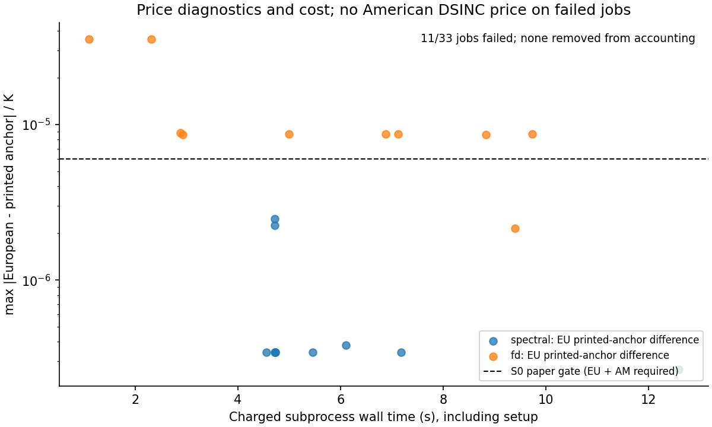
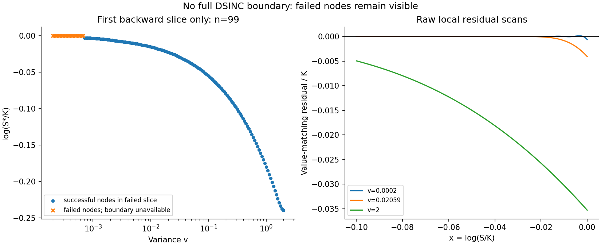
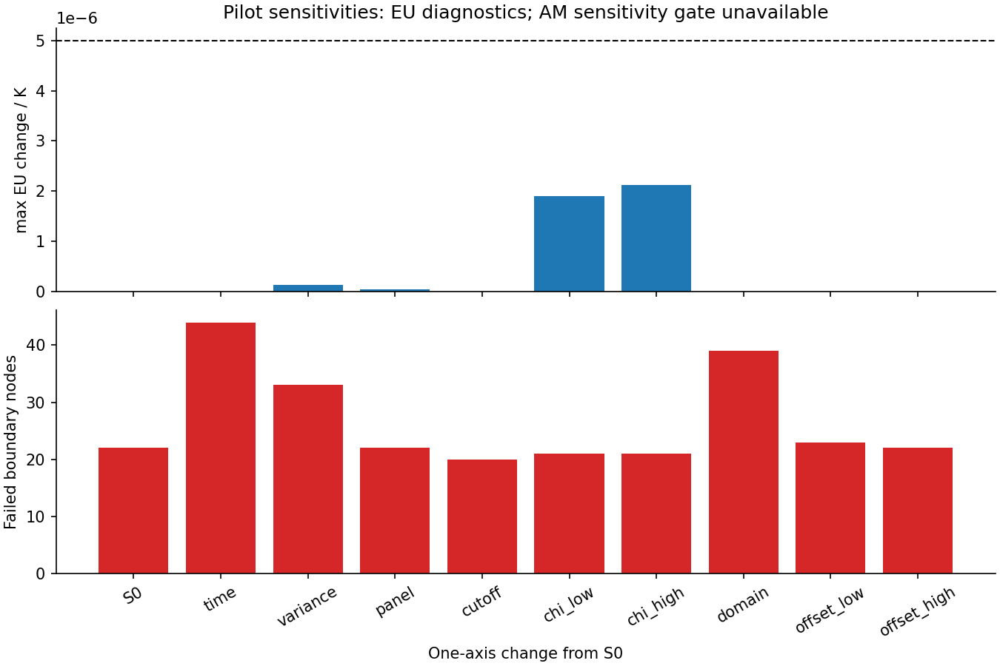

# DSINC v1: pilot結果と採否

2026-10-25 JST。**現行設定ではAmericanを未再現・不採用。主計算は実行していない。** 実装・基礎検算・予算付きpilotは終了し、Opus R1はAPPROVE、Critical/Important0。最終再実行の同一性確認も終了。

市場データを使わない定数係数3/2 putの研究。以下の値はすべてprice/KでK=1。テストPASSは実装の制御検算であり、再現認定と分ける。

## 停止した理由

1. S0の満期直前で複数の符号変化を検出した。T=.5/N100は22/160節点（v=.0002〜.000675）、N200は44/160。T=1/S0も22/160。失敗sliceの全節点と以前のnot_runを保存し、失敗境界をQへ伝播しない。American価格とEEPはnull。
2. 独立FDのx481→961点の最大変化はEuropean6.6737e-6、American7.7384e-6で、事前の5e-6基準を超えた。分散・時間細分とh固定のx領域拡大はこの基準を満たしたが、x未収束を相殺しない。
3. 完走したspectral Americanがないため、主実験のsolve費用係数は未測定。失敗した最初のsliceの時間から全Ntの費用を認定しない。

波数打切りと低分散の影響は原因候補。cutoff倍でも20/160が失敗し、原因は確定していない。rootの選別や基準の緩和は実施していない。T=1/S0の最初のstepはT=.5/N100と同じdt=.005の局所離散問題で、独立な再現追試とは扱わない。領域拡大では低分散34節点の複数根に加え、上端5節点(v約3.2〜4.0)にmissing_sign_changeがある。高分散では幅.3の窓が境界に届かない可能性があり、低分散の問題と区別する。

## 全6ケース

| T | S/K | DSINC European | DSINC American / EEP | paper設定FD fine American（診断） |
|---:|---:|---:|---|---:|
| 0.5 | 0.9 | 0.102557343413 | 未計算（boundary_failure） | 0.107592517206 |
| 0.5 | 1 | 0.047224262980 | 未計算（boundary_failure） | 0.048648138586 |
| 0.5 | 1.1 | 0.019104661425 | 未計算（boundary_failure） | 0.019489563282 |
| 1 | 0.9 | 0.107567242016 | 未計算（boundary_failure） | 0.116328783741 |
| 1 | 1 | 0.060212820634 | 未計算（boundary_failure） | 0.063658215394 |
| 1 | 1.1 | 0.032301396272 | 未計算（boundary_failure） | 0.033686926067 |

FD fineはx=[-1.2,1.2]、nv201、nx481、nt=600*T、分散領域[log(.0002),log2]。論文のFD印刷値との差はT=.5で最大5.18e-7、T=1 ATMで2.16e-7。独立FDの広い分散領域とは区別する。FD文献値は診断で、停止gateではない。

paper_matchはT=.5のEuropean3点がPASS（最大3.4342e-7）、American3点とT=1 ATMが未計算でFAIL。T=1非ATMはnot_availableを維持する。independent_validatedは全6点false。再現済みの宣言範囲はない。

## 費用と保存

- pilot33ジョブ: 完了22 / 境界失敗11、charged subprocess wall 200.294秒（setup・失敗込み）。solver内の計測は172.247秒。queryのみの.102秒を総費用とは扱わない。
- peak RSS最大641,482,752 bytes、最大job wall 12.997秒。全jobが180秒/2 GiB以内、phase10分以内。
- 保存見積もり15 MiB/peak0.9 GiB、実測pilot（図込み）3,403,485 bytes。propagatorや全FD面は保存しない。Gitには221 KBのsummary、34 KBの小境界証拠、3図、ineligible freezeを残す。du -shは最終pilot 3.6M、全検証証拠root 6.6M。
- 全98 mainジョブのroster/閾値/source hashをfreezeしたがeligible=false。実際のmain CLIも起動前に拒否し、main出力rootを作っていない。S1/S2・採用候補の正式感度・反復費用比較は未実行で、速度優位を主張しない。Hestonは最初の1入力を監査し、残り10入力はcases.jsonへの転記だけで未実行。

## 保存結果と再確認

- [pilot_summary.json](pilot_summary.json): 全33jobのraw価格・Delta bump・失敗配列の可逆要約・入力/source hash・gate再計算結果。
- [freeze_manifest.json](freeze_manifest.json): 主実験を拒否する固定契約。許容差は承認済み仕様のまま。
- [diagnostic_evidence.npz](diagnostic_evidence.npz): S0残差scanと独立FDの小さな最終価格/境界bracket。full面やM_kは含まない。
- 原結果は/home/kazumasa/projects/_data/johnhull/DSINC/implementation-2026-10-25/pilot-final/results.json。summaryにSHA-256と全artifact hashを保存。run.py --replayは全hash・固定roster・価格/FD収束/境界gate・slots/費用/採否を再計算する。mainではfreezeも検証する。

## 図

3図は保存データだけから作成し目視した。正常な全時刻境界が得られていないため、境界図は最初の失敗sliceの成功点と失敗点を示す。ノード数が変わる感度では失敗件数の分母も変わる（全設定はsummary）。

## 次の判断

現行v1はここで停止する。次版では複数根の原因切り分けと境界表現の再設計、FDのx格子/初期payoff処理の収束設計を、固定精度・資源予算と一緒に再レビューする必要がある。現在の基準を黙って緩めて主計算へ進めない。公開API、市場較正、全American商品への一般化、本編サイト組込みは範囲外。

## レビュー後の補足

既存の257点scanから符号変化区間を[小診断](root_scan_diagnostics.json)へ抽出した。新しいsolver実験は追加していない。低分散端では窓内の複数箇所で符号が反転する。これは余分な根を都合よく選ぶ根拠にはしない。

粗い概算では最終GLパネルの周波数節点は|x|=.1で一波長あたり平均約2.4点、cutoff倍で足した帯域では約1.2点に過ぎない。パネル+4/cutoff倍を完全に分離した周波数分解能検査とは主張しない。原因を特定したものではなく、次版で扱う設計上の論点である。

FDの相補性はIT projectionから構成的に満たされる。精度の独立な証拠には使わず、BSM/CRR、SDE作用、軸別収束、分割後のmax_equation_defectと合わせて解釈する。

費用予測は事前の保守的な掛け算であり、S2/T=1のsolve次元はS0/T=.5の約208倍。rootが通っても、S0の完走solveが約.43秒を超えると2倍の安全係数込みで180秒を超える見込みである。今回は完走係数未測定のため、予測値を埋めずmain不可とした。予測式も次版で再レビューする。

## 最終検証

- Opus R0の重要4点を是正し、R1はAPPROVE（Critical0/Important0）。任意Minor5点のうちfreeze実ファイルの改竄テスト1点を追加済み、残りは[レビュー記録](../../docs/superpowers/reviews/2026-10-25-dsinc-american-implementation-opus.md)に明記。
- 最終33ジョブでinput hash33、価格ベクトル33、圧縮NPZ32のhashが前回とビット一致。失敗集合/ラベルも一致。2回のpilot合計401.537秒。旧rootは置換し、旧SHA/全費用をsummaryへ保持。
- 是正前の全体hullkit/reportは7822PASS/6skip/2既存warning（467.50秒）。是正後の変更範囲はDSINC5suite+索引/docstringの1024PASS（32.73秒）、12Pythonのruff/format PASS。全体suiteを是正後に再実行したとは記さない。
- release checkは基点と現行の同一scriptで同じFAIL（worktreeに生成portal15 HTML不足）。本編を再生成していない。
- [validation.json](validation.json)に各検証の対象epoch、hash、費用・保存量を固定。
